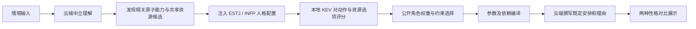

# Personality Behavior Engine — KEV 人格行为对比

对同一个车载情境，对比 ESTJ 与 INFP 的行为、地点/内容选择、车机回复和选择理由。支持十个预设情境及自由输入，保留原版完整链路、快速入口和审计页面。

## 快速开始

需要 **Python 3.12、Git**；运行 KEV 另需下载模型。Apple Silicon 使用 MLX；其他平台根据 KEV 上游支持使用 CUDA 或 CPU。当前环境验证基于 Apple Silicon，其他硬件未在本项目上实测。

```bash
python3.12 -m venv .venv
source .venv/bin/activate
python -m pip install -r requirements.txt
python web/app.py --host 127.0.0.1 --port 10086
```

Windows 使用 `.venv\Scripts\activate` 激活环境。依赖本项目的 `requirements.txt`；`requirements.lock.txt` 是早期环境快照，不是本版本的安装锁文件。

1. 打开 [API 设置](http://127.0.0.1:10086/settings/models)，填写 Base URL、模型名及自己的 API Key，点击保存并测试连接。
2. 按 [KEV 安装说明](docs/KEV_SETUP.md) 启动本地 0.8B 模型服务。
3. 打开 [KEV 对比页](http://127.0.0.1:10086/demo/kev)，选择场景或自由输入，再点击开始对比。选择场景不会自动生成。

默认 API 地址为 `https://www.fucheers.top/v1`，模型名 `claude-opus-5-5`，均可在设置页修改。此名称由接口供应商提供，具体可用模型以自己的账户为准。仓库不含可用 API Key。

## 页面入口

| 入口 | 用途 |
|---|---|
| `/demo/kev` | 推荐：KEV 人格行为对比 |
| `/settings/models` | API 地址、模型、Key、分阶段超时、真实连接测试 |
| `/demo` | 原模型人格对比 |
| `/fast` | 快速行为入口 |
| `/` | 原版人格导游 |
| `/comparison` | 原始完整对比台 |
| `/flow_review` | 分步审计、提示词查看与重跑 |

## 当前 KEV 链路



- 情境理解阶段不注入人格；两种性格共享本轮事实和资源池。
- KEV 是受限选项决策模型，负责评分；云端模型负责中文理解、共享候选资料及最终表述。
- 当前支持 57 项原子能力评分，实际调用范围由情境、用户要求、安全约束和依赖决定。
- 为使差异可见，本项目使用公开的人为角色强化权重。KEV 原始分数、综合优先分和最终采用结果应分别解读；综合优先分不是校准后的真实概率，也不是 MBTI 科学因果证明。
- 当前未连接真实车机、地图或音乐平台。候选地点、内容和执行反馈用于行为对比；前端采用自然车机口吻，后台保留资料来源和审计。
- 最终表达只改写已选安排，不应重新选择地点、歌曲或增加动作。云端异常时会显示阶段错误或使用编译结果，不伪造成功。

详细模块和参数见 [方案说明](docs/KEV_ARCHITECTURE.md)。早期七步主流程交接文档完整保留在 [LEGACY_V3.md](docs/LEGACY_V3.md)，仅说明旧入口，不能代替当前 KEV 链路说明。

## 包含内容

`engine/` 全部引擎代码；`web/` 全部前端、模板和后端；`config/` 原子能力、人格、场景和强化规则；`prompts/` 与 `prompt_versions/` 提示词及版本；`adapters/`、`schemas/`、`cases/`、`scripts/`、`tests/` 与设计文档。

不上传模型权重、虚拟环境、密钥、运行日志、用户输入历史及生成缓存。首次运行会自行创建 `output/`，旧案例记录不随代码分发。KEV 权重下载地址及固定版本见 [KEV_SETUP.md](docs/KEV_SETUP.md)。

## API 配置如何保存

设置页的实现代码完整包含在 `web/model_settings.py`、`web/templates/model_settings.html` 和 `engine/local_cloud.py`。每位使用者自行填写 Key，保存为本机 `.local-cloud.json`（文件权限 0600，Git 忽略）；读取设置的接口只返回是否已配置 Key，不返回密钥正文。更换接口地址会清除旧 Key，避免发送给其他供应商。

设置入口只允许本机回环地址访问；默认监听 `127.0.0.1`。如需多人远程部署，应另行增加认证和配置管理，当前启动命令面向本机使用。

## 测试

```bash
python -m pip install -r requirements-dev.txt
python -m pytest tests -q
node --test tests/*.cjs
```

离线单元测试使用替身，不代表真实云端或新硬件上的推理验收。连接测试会调用使用者配置的 API，可能消耗额度。

## 第三方依赖

KEV 上游：[jaredpalmer/kev](https://github.com/jaredpalmer/kev)（Apache-2.0）；模型与底座的下载及授权说明见 [KEV_SETUP.md](docs/KEV_SETUP.md)。不在本仓库重复分发其权重或源码；第三方授权以各自仓库为准。
