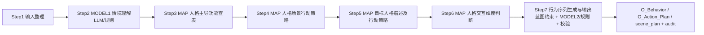

# Personality Behavior Engine V3（交接说明）

配置驱动的车载人格行为映射引擎 V3，位于 `/data/lzh/Benz/szy/personality_behavior_engine_v3`（从 `/data/lzh/personality_behavior_engine_v3` 复制）。

本文写给**下一位接手者**，说明两件事：

1. V3 现在实际做了什么（与代码一一对应）；
2. V3 与旧仓库 `/data/lzh/Benz/szy/personality_behavior_engine` 的差异。

---

## 0. 一句话定位

**规则 + 配置决定「骨架」，LLM 只在骨架上生成细节。**

- Step 2 情境理解、Step 7 行为序列生成是仅有的两个 LLM 环节（后端可切 `rules`，即纯规则）；
- 其余步骤是查表（人格/认知功能/场景/交互维度）与规则校验；
- LLM 失败一律回退规则结构，`rules` 后端可跑通全链路；
- 输出不含车机语音台词，是评审友好的解释型行为方案。

---

## 1. V3 最近做了什么（速览）

- **主流程重构**：从旧 12 步（打分→采样→编排为主决策）切到《行为映射技术流程定义.md》的 7 步主流程（Step 1 输入 → Step 7 行为序列生成与输出）。
- **蓝图（Blueprint）机制**：行为序列生成前，规则层先冻结「场景骨架 = must 域（必须涉及）＋ optional 域（安全允许、可选调用）」，模型只能在骨架内挑选原子动作，不得调用骨架外能力。
- **原子能力两层级**：`config/capabilities.yaml` 从平铺 7 个一级能力，升级为「一级能力域 + 二级 atomic_abilities」；模型输出的原子动作名只能取自该表。
- **无 MBTI 基线**：Web 对比新增 `NO_MBTI` 变体（空功能栈、`scenario_only`），用于对照「纯情境基线」与人格影响。
- **三人格并行**：正式对比台一次请求把 INFP / ESTJ / NO_MBTI 三路用 `ThreadPoolExecutor` 并行跑（`pool.map` 保持顺序），不再串行。
- **可靠性与可观测性**：LLM 请求 `timeout_sec=120`、`race_n=3`（同请求三线程竞速取最先成功）；每次 LLM 调用写 `output/llm_calls/llm_calls_YYYYMMDD.jsonl`（`engine/llm_call_log.py`）。
- **Web 双入口同端口**：10086 上 `/` = 正式对比台，`/flow_review` = 审计版（7 步分步审阅，可改 Step 2/7 的 system/user prompt 后重跑）。
- **默认模型**：`default_backend: openai` → `gpt-5.6-terra`（ju-guang 网关）。
- **UI 迭代（近期）**：容器放宽到 1760px 自适应屏幕；「执行顺序」逐条编号换行展示；「可用情境」收敛为 `上车迎宾` / `情感抚慰` 两项；后端下拉文案 `gpt-5.6-terra`。

---

## 2. 当前 7 步主流程

入口：`Engine.generate_behavior_plan`（`engine/pipeline.py`），每一步产出 1 条 `audit_steps`（含 input/output/rules_hit/model_version/prompt_used/raw_llm_text/status）。



| Step | 名称 | 处理 | 产物 |
|---|---|---|---|
| 1 | 输入整理 | 程序整理 | 标准化 request（persona + user_utterance + context/history + available_capabilities） |
| 2 | 情境理解（MODEL 1） | LLM（失败→规则关键词/正则回退） | `scenario_id`、`parsed_context`（emotion/risk/needs/evidence/confidence） |
| 3 | 人格主导功能查表 | 查 `personas.yaml` | dominant/auxiliary/… 功能栈（NO_MBTI 为空栈） |
| 4 | 人格场景行动策略 | 查 `cognitive_functions.yaml` + `scenarios/*.yaml` | 该人格在该场景的行动策略描述 |
| 5 | 目标人格描述及行动策略 | 查 `cognitive_functions.yaml` | 主导功能的 principle / action_logic 等 |
| 6 | 人格交互维度判断 | 查 `interaction_dimensions.yaml` | stance / explanation_focus / timing / ordering 等（scale 1-5） |
| 7 | 行为序列生成与输出（MODEL 2） | 蓝图约束 + LLM（失败→`plan_from_blueprint`）+ 规则校验/补强 | `O_Behavior` / `O_Action_Plan` / `scene_plan` / `behavior_call_type` |

Step 7 之后的动作是**确定性修正**：白名单外能力丢弃；`safety` 下禁 entertainment/ambient_light；forced_caps 缺失补回；按 order 重排。

---

## 3. 蓝图机制（核心设计，务必理解）

蓝图在 Step 6 之后、Step 7 之前由纯规则计算（`_build_blueprint`，pipeline.py），模型不能绕过。

- **must 域（`scene_backbone`）**：场景骨架。
  - `safety` / `explicit`：= 规则强制能力（forced_caps）；
  - `no_tool`：骨架为空（本轮不调用）；
  - 普通流程：按 `scenario_id` 查情境表（如 `time_pressure`→navigation+notification_mode，`temperature_control`→climate，`pleasant_trip`→ecosystem+navigation 等），再做 whitelist 过滤、forbidden 剔除、人格微调（ESTJ 导航置顶、INFP 提前 ecosystem、热不适 climate 前置等）。
- **optional 域（`optional_capabilities`）**：= 白名单中不在骨架、且未被安全禁止的能力。`no_tool` 时为空。
- **hint（`capability_hints`）**：每个能力一条，带 `constraint: must | optional` 与规则推荐的 `intensity` / `execution_mode` / `parameters_hint`。
- **语义（下发给模型的决策规则）**：
  - `must` 域必须至少挑一个**二级原子动作**进入 `behavior_actions`，且该动作 `decision_state ∈ {required, conditional}`——每个 must 一级域各自至少要有一个二级动作落地；
  - `optional` 域由模型结合情境与人格自行决定是否调用（decision_state 可为 optional/conditional）；
  - 禁止调用 `capability_hints` 与 `optional_capabilities` 之外的能力域；
  - 不调用的一律进 `no_call`（reason：`blocked`=安全/强制阻止，`not_selected`=可选未用；白名单未调用域补 `no_call`）。
- **输出结果结构**：`scene_backbone / mandatory_capabilities / optional_capabilities / capability_hints / no_call_reasons / notes / persona_description / interaction_profile`。
- **候选打分**：`score_all` 仍会算一遍候选排序，但**只进审计展示**（`_rank_capabilities_for_audit`），不再决定最终调用集。

---

## 4. LLM 后端与可靠性

| 项 | 值 |
|---|---|
| 后端枚举 | `rules`（纯规则，无 LLM）\| `carsona`（本地 7106 `carsona_simpo_4`）\| `openai`（ju-guang 网关 `gpt-5.6-terra`） |
| 默认 | `llm.default_backend: openai`（runtime.yaml） |
| 超时/竞速 | `timeout_sec: 120`，`race_n: 3`（`engine/race_first.py`：同请求 3 线程竞速，取第一个成功；单线程失败仅记录，全失败才抛） |
| 调用日志 | `engine/llm_call_log.py` → `output/llm_calls/llm_calls_YYYYMMDD.jsonl`（线程锁写，失败静默） |
| 错误分类 | auth/permission/timeout/rate_limited/model_not_found/network 等（`describe_llm_error`），audit 里 `status=fallback` |

客户端每次 `get_llm` 新建实例（无模块级缓存），因此 Web 多线程/多人格并行天然隔离。

---

## 5. Web：两个入口（同一进程、同一端口 10086）

`web/app.py` 用 `_SubAppMount` 做 WSGI 前缀分发，`web/flow_review_app.py` 挂到 `/flow_review`。

### `/` —— 正式展示版（对比台）

- 输入：自然语言情境（可点「可用情境」标签/预设 case 预填）＋ 模型后端。
- 固定对同一情境并行跑 **INFP / ESTJ / 无 MBTI 基线** 三路（`POST /api/run`，`ThreadPoolExecutor` 并行、顺序保持）。
- 展示：快速总览卡 → 关键差异摘要 → 能力调用对比矩阵（O_Behavior 逐能力三路对照）→ 逐组审计。
- 落盘：`output/custom/{request_id}_{persona}.json` + `{base_request_id}_compare_bundle.json`。
- `persona` 非法值返回 400；`compare_variants=false` 时只跑单人格。

### `/flow_review` —— 审计版（分步审阅）

- `STEP_COUNT = 7`，与主流程 7 步对应。
- 逐步确认：只能打开到 `confirmed_step + 1`（`POST /session/<id>/step/<n>/confirm`）。
- Step 2 / Step 7 展示模型实际使用的 **system/user prompt** 与 `raw_llm_text`；可编辑 prompt 后单步重跑（`rerun`），或整链重跑（`rerun_all`，调用 `rerun_from_review_step`）。
- Session 落盘：`output/flow_review/{session_id}.json`。

---

## 6. 与旧仓库的差异

旧仓库：`/data/lzh/Benz/szy/personality_behavior_engine`（V3 的上游/演进基线）。

| 维度 | 旧版 `Benz/szy/personality_behavior_engine` | V3（当前） |
|---|---|---|
| 主流程/审计 | 12 步审计（Step7-9 打分→采样→compose 是决策核心） | 7 步审计（情境理解 + 人格查表 + 行为序列生成） |
| 能力模型 | `capabilities.yaml` 平铺 7 个一级能力 | 一级能力域 + 二级 `atomic_abilities`；原子动作名是模型唯一可输出集合 |
| 能力决策 | `scorer.score_all` 加权打分 + `sampler.select` 可复现随机（temperature/top_k/seed）+ `behavior_composer` 编排 | **蓝图**：场景骨架 must 域 + optional 域 + 校验补强；打分仅入审计展示（`sampler`/`behavior_composer` 主流程不再引用） |
| 执行方式 | 单一 `execution_mode` 枚举（auto/confirm/suggest），由 `decide_execution_mode` 规则给出 | 新增 `config/execution_modes.yaml` 执行方式表；决策规则把执行方式按动作类型匹配（自动生成/自动执行/条件自动/确认后执行/选择后执行/仅建议） |
| 蓝图/blueprint | 无 | 有（见 §3） |
| 人格 | personas.yaml 仅 INFP/ESTJ | 同上 + Web 支持 **NO_MBTI 无 MBTI 基线** 变体对照 |
| 默认后端/模型 | `default_backend: rules`；openai=`gpt-4o`；timeout 90 | `default_backend: openai` → `gpt-5.6-terra`；timeout 120；`race_n=3` |
| LLM 可观测 | 无调用日志 | `llm_call_log.py` JSONL；audit 记录 prompt_used/raw_llm_text/fallback |
| Web | 单入口 `/`，一次请求单人格，跑 12 步审计 | 10086 双挂载：`/` 正式对比台（三人格并行对比）+ `/flow_review` 审计版（7 步分步审阅/改 prompt 重跑） |
| 场景目录 | `scenario_catalog` 9 类全部展示 | 引擎仍按 9 类情境表处理；UI「可用情境」收敛为 `上车迎宾`/`情感抚慰` 两项（演示聚焦，可随时在 runtime.yaml 加回） |
| 新增文件（相对旧版） | — | `engine/race_first.py`、`engine/llm_call_log.py`、`web/flow_review_app.py`、`web/templates/flow_review_{index,step}.html`、`config/execution_modes.yaml`、`tests/test_compare_variants.py`、`docs/当前流程说明.md`、`行为映射技术流程定义.md` |
| 流程定义文档 | 无 | 《行为映射技术流程定义.md》（7 步定义 + 原子能力表 + 执行方式表 + 8 荣格功能场景策略/交互维度表） |

> 注：`docs/当前流程说明.md` 描述的仍是旧 12 步链路的讲解，属于历史说明，V3 实际主流程以其开头「注」与《行为映射技术流程定义.md》为准。

---

## 7. 目录与模块

```text
engine/
  pipeline.py            # 主流程：Engine、generate_behavior_plan、_build_blueprint、_compose_from_actions
  model_intent.py        # Step2 MODEL1：run_intent（LLM + 规则回退）
  model_planner.py       # Step7 MODEL2：PLANNER_SYSTEM 决策规则、run_planner、plan_from_blueprint
  llm_router.py          # 后端解析/客户端构造/JSON 抽取
  llm_client.py          # OpenAI 兼容 client（timeout/race 参数）
  race_first.py          # 同请求多线程竞速
  llm_call_log.py        # LLM 调用 JSONL 日志
  registries.py          # 加载 config/*.yaml + scenarios/*.yaml 为只读注册表
  rule_filter.py         # 安全/显式/白名单/禁用过滤（safety/explicit/no_tool 判定）
  scorer.py / sampler.py / behavior_composer.py   # 旧决策链模块，V3 主流程不再作为决策使用
  output_builder.py      # O_Behavior / O_Action_Plan / scene_plan 拼装
  audit_narrator.py      # 审计步骤 → 自然语言叙述
  trace_logger.py        # make_step / audit / decision_trace 结构
  context_parser.py      # 规则侧上下文解析
  response_generator.py  # 未接线（历史遗留）
web/
  app.py                 # 正式对比台 + _SubAppMount 双挂载
  flow_review_app.py     # 审计版（7 步分步审阅 + 改 prompt 重跑）
  templates/index.html   # 对比台页面
  templates/flow_review_index.html / flow_review_step.html
config/
  runtime.yaml           # 默认后端/模型/timeout/race_n/defaults/scenario_catalog/capability_order
  capabilities.yaml      # 一级能力域 + 二级 atomic_abilities
  execution_modes.yaml   # 执行方式表（V3 新增）
  personas.yaml / cognitive_functions.yaml / scenarios/*.yaml /
  interaction_dimensions.yaml / scoring.yaml / safety_rules.yaml
output/                  # custom / cases / flow_review / llm_calls
docs/当前流程说明.md      # 历史讲解（偏旧，见 §6 注）
行为映射技术流程定义.md   # V3 主流程的权威定义
```

---

## 8. 快速开始

```bash
cd /data/lzh/personality_behavior_engine_v3
python3 -m pip install -r requirements.txt
python3 -m pytest tests/ -q        # 规则链路测试（无需 LLM）

# 启动 Web（默认后端 = openai / gpt-5.6-terra）
python3 web/app.py --host 0.0.0.0 --port 10086
#   正式对比台 -> http://127.0.0.1:10086/
#   审计版     -> http://127.0.0.1:10086/flow_review

# 纯规则链路（不调模型）直接在页面把「模型后端」切到 纯规则，或：
#   修改 config/runtime.yaml 中 llm.default_backend 为 rules
```

模型与超时配置均在 `config/runtime.yaml`：

```yaml
llm:
  default_backend: openai      # rules | carsona | openai
  carsona: {base_url: ..., model: carsona_simpo_4, timeout_sec: 120, race_n: 3}
  openai:  {base_url: https://ai.juguang.chat/v1, model: gpt-5.6-terra, timeout_sec: 120, race_n: 3, api_key: ...}
```

---

## 9. 交接注意事项

- **只在本目录内改动**；不修改外部 `carsona_agent` / vLLM。
- **敏感信息**：`config/runtime.yaml` 的 `openai.api_key` 为明文，勿提交到公开仓库（仓库有 `.env`，已被 gitignore）。
- **审计口径（人格改写语义）**：无论引擎行为序列还是话术改写，都要区分「已完成」与「计划中」——情境里已完成的事（如已选好充电站）不得被模型改写成未来规划。话术改写脚本在 `carsona_agent` 项目（`scripts/rewrite_pipeline.py`），与本引擎仓库分开维护，勿混淆。
- **改模板/配置后要重启**：服务以非 debug 模式启动时，Jinja 模板与 Engine 初始化有缓存，改 `web/templates/*.html` 或 `config/*.yaml` 后需重启进程才生效（`load_runtime()` 每次读取，但模板编译结果会被缓存）。
- **多人格并行**依赖 Engine 只读注册表 + `get_llm` 每次新建客户端；若将来给 Engine 加可变状态，需回到「每线程独立 Engine」。
- **场景选项**收敛为两项仅为 UI 聚焦；引擎的情境表（`config/scenarios/`）仍支持 9 类场景，展示目录在 `runtime.yaml: scenario_catalog` 维护。
