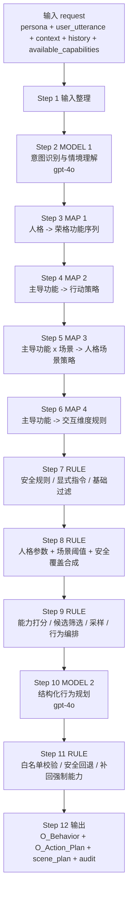
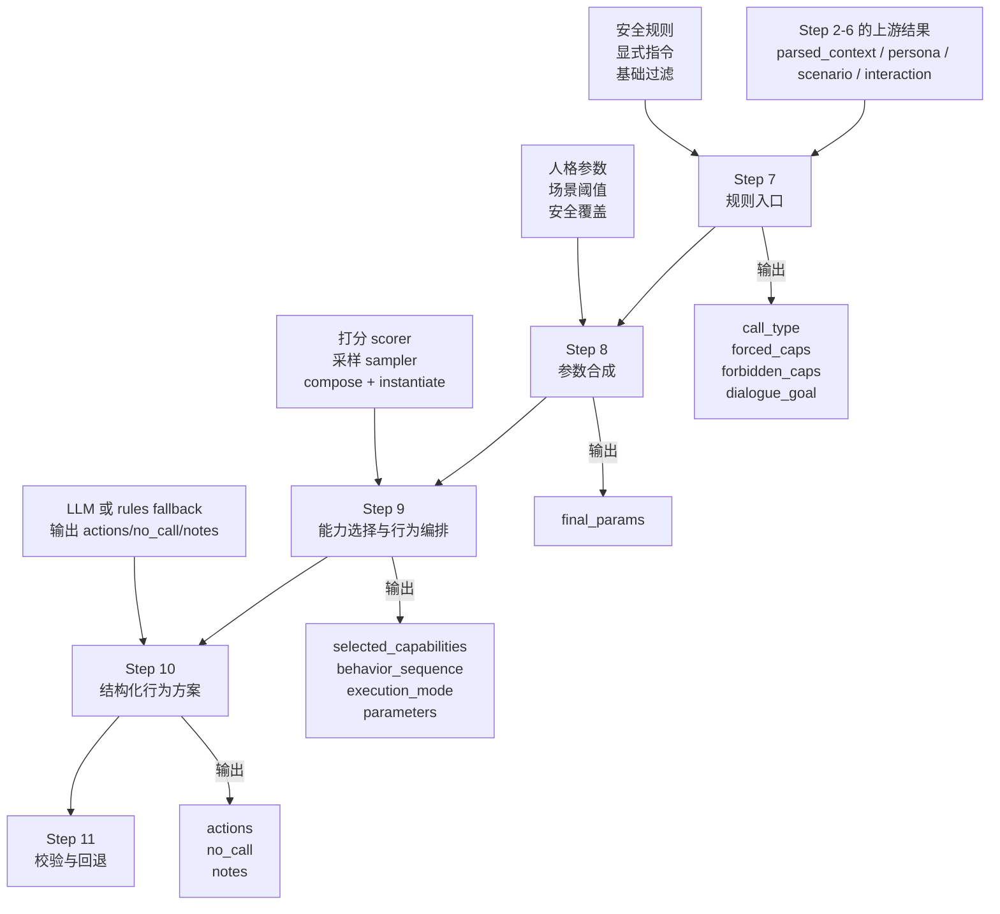

# 当前流程说明

本文档用于帮助理解 `personality_behavior_engine_v3` 当前 demo 的执行链路。

> 注：V3 已按《行为映射技术流程定义》重构。当前核心不再以“能力打分 + 采样 + compose”作为主流程，而是先形成“情境理解 / 人格功能 / 场景策略 / 交互维度”四类流程材料，再生成行为序列。下文若仍提到旧版中间模块，应以代码中的最新 pipeline 为准。

## 前提假设

- 假设模型后端选择 `openai`
- 假设模型名为 `gpt-4o`
- 因此，流程中的 `MODEL 1` 和 `MODEL 2` 按“调用 LLM”理解
- 其余步骤仍然主要由配置表、规则和程序化打分完成

说明：

- 这不代表项目当前默认配置一定就是 `gpt-4o`
- 这里只是为了看清“如果使用 LLM 后端，完整链路怎么走”

## 一句话结论

这个 demo 不是“全靠 LLM”，而是：

`2 个 LLM 步骤 + 4 个查配置表步骤 + 4 个规则/打分步骤 + 2 个输出整理步骤`

也就是说：

- LLM 负责“理解情境”和“把结果整理成结构化行为方案”
- 真正决定“调不调用能力、优先级怎么排、哪些能力禁止/强制”的主体，仍然是规则和配置

## 总流程图



## Step 7 / 8 / 9 / 10 职责边界图

这四步最容易混在一起。

一句话先说清：

- Step 7：先做规则分流，判断有没有安全优先或显式指令直通
- Step 8：把人格、场景、安全约束合成统一参数
- Step 9：真正决定选哪些能力，以及这些能力具体怎么组织
- Step 10：把前面已经基本确定的结果整理成结构化方案



### 四步职责对照

| Step | 负责什么 | 不负责什么 |
|---|---|---|
| 7 | 规则分流，先定是不是安全优先、显式指令优先、还是普通评分流 | 不做完整的候选排序与参数实例化 |
| 8 | 合成人格参数、场景阈值、安全覆盖，生成统一的 `final_params` | 不直接选能力 |
| 9 | 真正选能力，并决定顺序、强度、执行方式与具体参数 | 不负责最终展示包装 |
| 10 | 把前面结果整理成结构化 `actions/no_call/notes` | 不是底层动作的核心裁判 |

### 最重要的一句

如果问“到底是哪个环节决定具体要用哪个车控做什么事”，最准确的答案是：

- Step 7：前置硬规则闸门
- Step 8：参数合成
- Step 9：核心决策层
- Step 10：结构化整理层

也就是说，真正的核心决定主要发生在 `Step 9`。

## 每一步在做什么

| 步骤 | 名称 | 主要输入 | 主要输出 | 处理方式 |
|---|---|---|---|---|
| 1 | 输入整理 | `persona`、`user_utterance`、`context`、`history`、`available_capabilities` | 标准化后的请求 | 程序整理 |
| 2 | MODEL 1 | 用户文本、人格、默认上下文 | `scenario_id`、`parsed_context`、上下文覆盖 | LLM |
| 3 | MAP 1 | `persona` | 功能序列、功能分数 | 查 `personas.yaml` |
| 4 | MAP 2 | 主导功能 | 行动策略、原则、动作逻辑 | 查 `cognitive_functions.yaml` |
| 5 | MAP 3 | 主导功能、`scenario_id` | 某人格在该场景下偏好的 needs | 查 `scenarios/*.yaml` |
| 6 | MAP 4 | 人格交互参数、主导功能 | 交互维度说明 | 查 `interaction_dimensions.yaml` |
| 7 | RULE | `parsed_context`、风险、显式请求、可用能力 | 是否进入 `safety` / `explicit` / 普通评分流程 | 规则判断 |
| 8 | RULE | 人格交互参数、场景阈值、安全覆盖信息 | `final_params` | 规则合成 |
| 9 | RULE | 候选能力、needs、人格分数、历史、上下文 | 选中的能力、调用顺序、执行模式、行为序列 | 打分 + 采样 + 组合 |
| 10 | MODEL 2 | `final_params`、白名单、规则摘要、needs | 结构化 `actions/no_call/notes` | LLM |
| 11 | RULE | `actions`、白名单、强制能力、安全规则 | 修正后的 actions | 校验/回退 |
| 12 | 输出整理 | 修正后的 actions 和中间结果 | `O_Behavior`、`O_Action_Plan`、`scene_plan`、审计轨迹 | 程序拼装 |

## 分层理解

### 1. 输入层

输入数据长这样：

```json
{
  "persona": "INFP",
  "user_utterance": "我有点热，走吧",
  "context": {},
  "history": {},
  "available_capabilities": [
    "climate",
    "entertainment",
    "ambient_light",
    "navigation",
    "notification_mode",
    "seat",
    "ecosystem"
  ]
}
```

这一层只负责把请求形状整理好，还没有真正做决策。

## Step 2：MODEL 1 做什么

这是第一个 LLM 步骤，假设用的是 `gpt-4o`。

它的任务不是直接决定“开空调还是开导航”，而是先把自然语言理解成结构化中间结果，例如：

- 当前属于哪个场景 `scenario_id`
- 用户显性意图是什么
- 隐含需求有哪些
- 情绪标签是什么
- 风险程度多高
- 哪些上下文字段需要覆盖

### Step 2 的输入

- `persona`
- `user_utterance`
- 默认 `context`
- 场景候选列表

### Step 2 的输出

- `scenario_id`
- `summary`
- `parsed_needs`
- `emotion`
- `risk`
- `context_overrides`
- 证据 `evidence`

### 这一层是不是查表

不是。

这里主要是 LLM 理解文本。

但要注意：

- 即使在 LLM 模式下，代码也会保留规则侧的兜底结构
- 如果 LLM 失败，会退回规则解析

## Step 3-6：人格映射层

这一段基本都不是 LLM，而是“查配置表”。

### Step 3：人格 -> 荣格功能序列

从 `config/personas.yaml` 读取：

- `function_scores`
- `interaction`

例如：

- `INFP` 更偏 `Fi`
- `ESTJ` 更偏 `Te`

输出的是这次推理的人格基础底盘。

### Step 4：主导功能 -> 行动策略

从 `config/cognitive_functions.yaml` 读取主导功能对应的：

- `action_strategy`
- `principle`
- `action_logic`

例如：

- `Fi` 更强调个人边界、自主权、低侵入
- `Te` 更强调目标、优先级、结果闭环

### Step 5：主导功能 x 场景

从 `config/scenarios/<scenario>.yaml` 读取：

- 在这个场景里，某类功能更偏好哪些 needs

例如 `welcome_on_board` 场景下：

- `Fi` 更偏 `emotional_comfort`、`personal_boundary`、`user_autonomy`
- `Te` 更偏 `task_completion`、`time_efficiency`

### Step 6：主导功能 -> 交互维度

从 `config/interaction_dimensions.yaml` 读取解释性规则，比如：

- 主动性
- 说明方式
- 节奏
- 是否保留更多用户选择空间

这一层主要服务于后面的：

- 参数合成
- 执行方式判断
- 解释文案

## Step 7-9：真正决定“调什么能力”的核心层

这一段最重要。

很多人第一眼会以为这里是 LLM 决策，其实不是。

这里主要是：

- 安全规则
- 显式指令优先
- 能力过滤
- 打分计算
- 采样
- 行为序列编排

### Step 7：规则入口

这里先判断三件事：

1. 是否触发安全规则  
   例如疲劳驾驶风险高，则直接进入安全优先流程

2. 是否有显式指令  
   例如“给我开空调”“导航回家”“播放音乐”

3. 如果都没有，再进入普通评分流程

这一层主要读取：

- `parsed_context.risk`
- `parsed_context.explicit_request`
- `config/safety_rules.yaml`

### Step 8：参数合成

把三类信息合成到一起：

- 人格参数：如 `initiative`、`confirmation`、`automation_level`
- 场景阈值：如最低调用分、是否允许多能力
- 安全覆盖：哪些能力强制、哪些能力禁止

这一步输出 `final_params`，供后面规划使用。

### Step 9：能力打分与选择

这一步会决定：

- 候选能力谁分高
- 最后选哪些
- 调用顺序怎样
- 自动执行还是先确认

这一步是整个 demo 的“决策心脏”。

## `capabilities.yaml` 在哪一步起作用

你现在打开的 `config/capabilities.yaml`，主要在 Step 7-9 发挥作用，尤其是 Step 9。

这个文件定义了每个能力的：

- 支持哪些需求 `supported_needs`
- 跟哪些认知功能更契合 `function_affinity`
- 风险 `risk`
- 侵入性 `intrusiveness`
- 可逆性 `reversibility`
- 是否需要确认 `requires_confirmation`
- 人格随机性上限 `max_persona_randomness`
- 历史偏好字段 `history_keys`
- 参数预设 `parameter_presets`

### 它不是“动作清单”，而是“能力画像表”

程序不会简单地说：

- 用户热了 -> 查表 -> 必定空调

而是更像：

1. 先从 Step 2 得到 needs / emotion / risk
2. 再结合人格、场景、历史、上下文
3. 计算每个 capability 的综合得分
4. 决定谁进候选、谁被压低、谁被剔除

### Step 9 的得分来源

能力最终分数主要由这些部分组成：

- `need_match`
- `cognitive_match`
- `scenario_match`
- `history_match`
- `interaction_match`
- `context_match`
- 减去 `risk_cost`
- 减去 `intrusion_cost`

所以 `capabilities.yaml` 不是单独做决策，而是作为打分的核心输入之一。

## Step 10：MODEL 2 做什么

这是第二个 LLM 步骤，假设用的是 `gpt-4o`。

它接收的是已经被规则层约束过的结果，不是自由发挥。

### Step 10 的输入

- `persona`
- `scenario_id`
- `whitelist`
- `final_params`
- `rule_summary`
- `emotion`
- `needs`
- `risk`

### Step 10 的任务

把前面已经筛好的结构，整理成：

- `actions`
- `no_call`
- `notes`

### 这一层能不能随便决定新能力

不能。

因为后面还有 Step 11 校验：

- 不在白名单里的能力会被删
- 安全场景下不该出现的能力会被删
- 规则强制要求的能力如果缺失，会被补回来

所以 MODEL 2 更像“结构化规划器”，不是最终裁判。

## Step 11：为什么还要再校验一次

因为即使有了 MODEL 2，系统仍然不完全信任它。

这一步会做三件事：

1. 白名单校验
2. 安全回退
3. 补回强制能力

也就是说：

- LLM 可以帮忙整理
- 但不能突破规则边界

## Step 12：最终给用户看的输出

最终会生成三类核心结果：

### 1. `O_Behavior`

逐个能力说明：

- 调用 / 不调用
- 调用程度
- 原因
- 参数要点

### 2. `O_Action_Plan`

只保留最终执行顺序，例如：

```text
空调调节 -> 导航发起
```

### 3. `scene_plan`

把这次系统理解、人格策略、调用顺序和安全说明，整理成一段可读的场景化方案。

注意：

- 当前 demo 不输出车机口语台词
- 更偏向“解释型行为方案”

## 到底哪些步骤是 LLM，哪些不是

| 类型 | 步骤 |
|---|---|
| LLM | Step 2、Step 10 |
| 查配置表 | Step 3、4、5、6 |
| 规则 / 打分 / 采样 | Step 7、8、9、11 |
| 输出拼装 | Step 1、12 |

## 你可以把这个系统理解成三层

### 第一层：理解层

- Step 2

作用：

- 把自然语言变成结构化情境

### 第二层：决策层

- Step 3 到 Step 11

作用：

- 根据人格、场景、能力画像、安全规则，决定该不该调能力、调哪些、按什么方式调

### 第三层：表达层

- Step 12

作用：

- 把最终决策整理成评审友好的结果结构

## 最终结论

如果假设后端是 `gpt-4o`，那么这个 demo 的真实形态是：

- `gpt-4o` 负责理解情境
- 配置表负责定义人格、场景、能力画像
- 规则和打分逻辑负责做主要决策
- `gpt-4o` 再把结果整理成结构化方案
- 最后程序再次校验，防止模型越权

所以它更接近：

`规则主导的混合系统`

而不是：

`完全由 LLM 端到端直接决策的系统`
